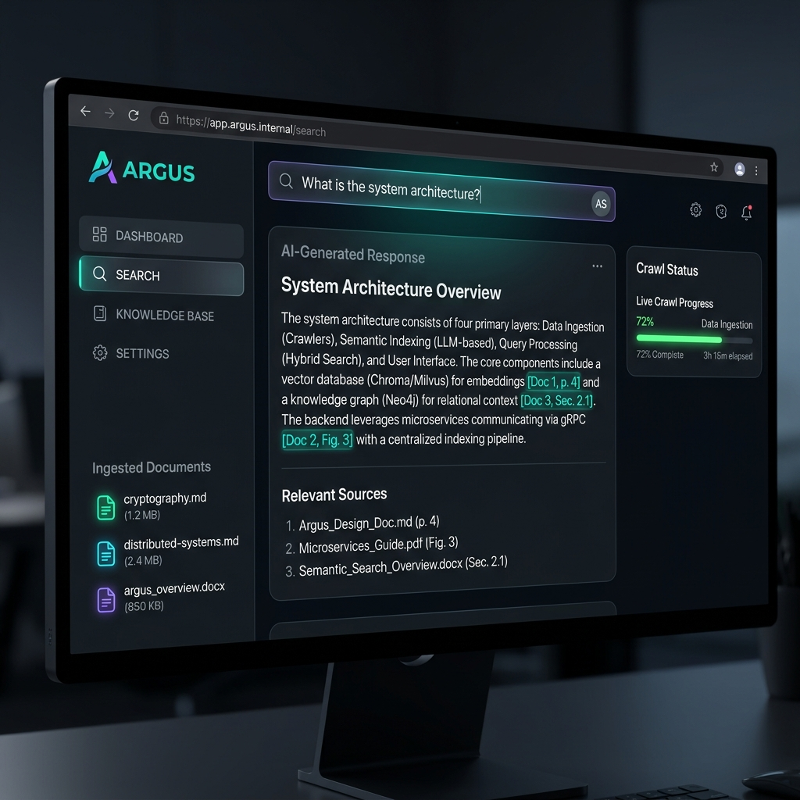

# 👁️ Argus — Fully Private Local Semantic Search & RAG Engine

A production-ready, local-first search and Retrieval-Augmented Generation (RAG) platform that runs entirely on your machine. Ingest documents, crawl websites, and query your knowledge base in plain English with zero data leakage, no cloud dependencies, and no API keys.



---

## Motivation

Most modern AI search and RAG platforms rely on cloud-hosted APIs (like OpenAI or Pinecone) to process, embed, and query user data. This means sending proprietary code, sensitive documents, and personal notes to external servers, exposing organizations and individuals to serious data privacy risks, network latency, and mounting API costs. 

I built **Argus** to prove that you do not need the cloud to have a lightning-fast, highly intelligent semantic search engine. By combining Go’s concurrency model for live web crawling, FAISS for instant vector retrieval, and Ollama for local LLM synthesis, Argus runs 100% locally on standard consumer hardware. It keeps your data exactly where it belongs: secure, encrypted, and completely on your machine.

---

## Architecture

```
┌─────────────────┐     HTTP      ┌──────────────────┐     HTTP      ┌──────────────────┐
│   React + Vite  │ ────────────► │   Go Backend     │ ────────────► │  Python Embedder │
│   :3000         │               │   :8080          │               │  :8081           │
│                 │               │                  │               │                  │
│  - Search UI    │               │  - REST API      │               │  - Chunking      │
│  - Ingest UI    │               │  - CORS          │               │  - Embeddings    │
│  - PDF upload   │  SSE stream   │  - PDF proxy     │               │  - FAISS index   │
│  - Live crawler │ ◄──────────── │  - Crawler pkg   │               │  - AES-256-GCM   │
└─────────────────┘               └──────────────────┘               │  - Ollama LLM    │
                                                                     │  - Disk persist  │
                                                                     └──────────────────┘
```

**The plumbing:**
- **Chunking**: text split at sentence boundaries with overlap so context isn't lost at edges
- **Embeddings**: `all-MiniLM-L6-v2` via sentence-transformers — a real 384-dim vector per chunk
- **Retrieval**: FAISS `IndexFlatIP` (inner-product / cosine ANN) with brute-force fallback
- **Synthesis**: Ollama running `llama3.2` locally — no OpenAI, fully private
- **Persistence**: FAISS index + chunks survive restarts via `embedder/data/`
- **Encryption**: AES-256-GCM on all stored chunks; key lives at `embedder/data/.key`
- **Crawler**: concurrent Go goroutines stream live progress to the browser via SSE
- **Transport**: Go handles HTTP routing and CORS; Python owns the ML workload

---

## Prerequisites

Install these first:

| Tool | Install |
|------|---------|
| **Go 1.21+** | https://go.dev/dl |
| **Python 3.12** | https://python.org — use 3.12, not 3.14 |
| **Node.js 18+** | https://nodejs.org |
| **Ollama** (optional) | https://ollama.ai — for LLM synthesis |

> **Note on Python version**: Use Python **3.12**. Python 3.14 is experimental and pre-built wheels for `numpy`, `faiss`, and `sentence-transformers` are not available yet — requiring a C compiler.

---

## Quick Start

```bash
# 1. Clone / unzip the project
cd argus

# 2. One command starts everything
./scripts/start.sh

# 3. Open browser
open http://localhost:3000
```

The first run will:
- Create a Python 3.12 virtualenv and install dependencies (~2 min)
- Download the `all-MiniLM-L6-v2` embedding model (~90MB)
- Pull `llama3.2` via Ollama (~2GB, one-time) — skipped if Ollama not installed

After that, startup is ~5 seconds. The index and all chunks are persisted to disk and loaded on boot.

---

## Manual Start (if you prefer)

**Terminal 1 — Embedder:**
```bash
cd embedder
python3.12 -m venv venv
source venv/bin/activate
pip install -r requirements.txt
python3 embedder.py
```

**Terminal 2 — Go Backend:**
```bash
cd backend
go mod download
go run main.go
```

**Terminal 3 — Frontend:**
```bash
cd frontend
npm install
npm run dev
```

---

## Usage

### Search
1. Type a question in the search bar
2. Press Enter or click **search**
3. Argus retrieves the top matching passages and synthesises an answer
4. Source passages shown below with cosine similarity scores

### Ingest text
1. Click the **ingest** tab in the sidebar
2. Paste any text (article, research paper, notes)
3. Give it a name (optional)
4. Click **+ ingest text**

### Ingest a PDF
1. Click **ingest** → **upload PDF**
2. Select any `.pdf` file
3. Argus extracts text page-by-page and indexes it

### Ingest a folder
1. Drop `.txt` or `.md` files into `docs-sample/`
2. Click **ingest docs/ folder**
3. All files are chunked and indexed at once

### Crawl a website
1. Click the **crawl** tab in the sidebar
2. Enter a URL (e.g. `https://go.dev/doc`)
3. Set max pages and toggle same-host mode
4. Click **start crawl** — live progress streams directly to the UI
5. All scraped pages are indexed automatically

---

## API Endpoints

The Go backend exposes these routes:

| Method | Route | Description |
|--------|-------|-------------|
| POST | `/api/ingest` | Ingest text `{ text, source }` |
| POST | `/api/ingest-pdf` | Ingest a PDF (multipart form) |
| POST | `/api/search` | Search `{ query, top_k }` |
| GET | `/api/status` | Corpus stats + capability flags |
| POST | `/api/ingest-dir` | Ingest all files in `docs-sample/` |
| POST | `/api/crawl` | Crawl a URL and stream progress via SSE `{ url, max_pages, same_host }` |
| POST | `/api/reset` | Wipe the entire index |

---

## Configuration

**Change the LLM model** (`embedder/embedder.py`):
```python
OLLAMA_MODEL = "llama3.2"   # or "mistral", "phi3", "gemma2"
```

**Change chunk size** (`embedder/embedder.py`):
```python
CHUNK_SIZE = 500    # characters per chunk
CHUNK_OVERLAP = 100 # overlap between chunks
```

**Disable encryption** (not recommended):
```bash
ARGUS_ENCRYPT=false python3 embedder.py
```

**Change number of results** — pass `top_k` in your search request.

---

## Feature Status

| Feature | Status |
|---------|--------|
| Text ingestion (paste) | ✅ Done |
| PDF ingestion (`pypdf`) | ✅ Done |
| Folder ingestion (`.txt`, `.md`) | ✅ Done |
| Web crawler (Go goroutines + SSE) | ✅ Done |
| FAISS ANN vector index | ✅ Done |
| AES-256-GCM encryption at rest | ✅ Done |
| Disk persistence (survives restarts) | ✅ Done |
| Ollama LLM synthesis | ✅ Done (optional) |
| Multi-user isolation | 🔲 Not yet |

---

## What Multi-User Isolation Means

Currently Argus is a single shared brain — one index, one encryption key, accessible to anyone on the network.

Multi-user isolation would add:
- **Auth tokens** — each user gets an API key
- **Namespace prefixes** — chunks tagged per user so searches are scoped
- **Per-user AES keys** — data encrypted separately so users can't access each other's documents

---

## Project Structure

```
argus/
├── backend/              # Go HTTP server
│   ├── main.go           # Routes, CORS, PDF proxy, SSE crawler endpoint
│   ├── go.mod
│   └── crawler/          # Embedded crawler package (goroutines + SSE events)
│       └── crawler.go
├── embedder/             # Python ML microservice
│   ├── embedder.py       # Chunking, embeddings, FAISS, AES-256-GCM, Ollama
│   ├── requirements.txt
│   └── data/             # Persisted index (gitignored)
│       ├── argus.faiss
│       ├── chunks.json   # AES-encrypted
│       └── .key          # AES-256 key (keep safe, never commit)
├── frontend/             # React + Vite UI
│   ├── src/
│   │   ├── App.jsx       # Search, Ingest, and live Crawl tabs
│   │   ├── index.css
│   │   └── main.jsx
│   ├── index.html
│   └── package.json
├── crawler/              # Standalone crawler binary (optional CLI use)
│   ├── crawler.go
│   └── go.mod
├── docs-sample/          # Drop your .txt / .md files here
│   ├── distributed-systems.md
│   ├── cryptography.md
│   └── mle-embeddings.md
└── scripts/
    └── start.sh          # One-command startup
```

---

## Contributing

We welcome contributions to Argus! Since Argus is composed of three services (Go, Python, and React), setting up local development is simple:

### Clone the Repository

```bash
git clone https://github.com/TobiWilliams001/Argus.git
cd Argus
```

### Local Development Flow

You can run each service individually as described in the **Manual Start** section, or make modifications directly.

- **Go Backend**: Navigate to `backend/` and use standard Go toolchain commands.
- **Python Embedder**: Navigate to `embedder/`, activate the virtual environment, and install dependencies.
- **React Frontend**: Navigate to `frontend/`, run `npm install`, and use `npm run dev`.

### Submit a Pull Request

If you have a feature request or bug fix:
1. Fork the repository.
2. Create a new branch (`git checkout -b feature/amazing-feature`).
3. Commit your changes.
4. Push to the branch (`git push origin feature/amazing-feature`).
5. Open a Pull Request.
